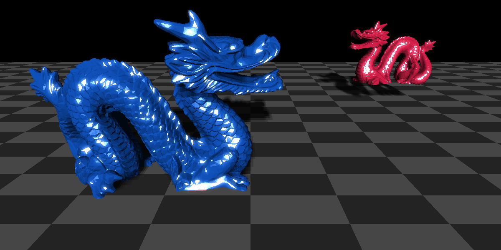
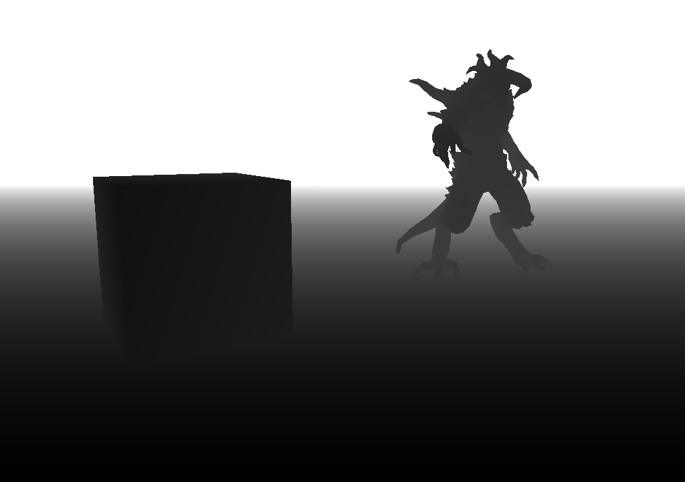
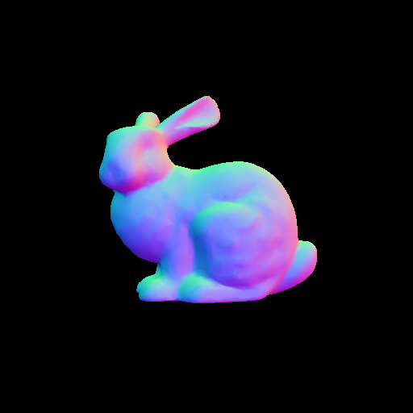

# raster

A software rasterizer written to better understand the inner workings of the GPU and its rendering pipeline.



## Features

- .obj model loading
- Perspective-correct interpolation
- Near-plane clipping
- Blinn-Phong shading
- UV texture mapping
- Shadow mapping with PCF
- Bloom effect

## Showcase

| Scene | Description |
|---|---|
|  | Z-buffer with models at varying depth |
|  | Stanford bunny colored with vertex normals |

## Usage

**Build:**
```bash
cmake -B build -DCMAKE_BUILD_TYPE=Release -DCMAKE_EXPORT_COMPILE_COMMANDS=ON
cmake --build build -j
```

**Render a scene:**
```bash
./build/rasterizer <bunny|depth_demo|dragons> [--frames N]
```

**Convert frames to gif:**
```bash
pip install -r scripts/requirements.txt
python3 scripts/frames_to_gif.py
```

## Roadmap

- SIMD rasterization

## References

### Papers

- [Pineda, J. (1988). *A Parallel Algorithm for Polygon Rasterization*](https://www.cs.drexel.edu/~deb39/Classes/Papers/comp175-06-pineda.pdf)

### Articles and Tutorials

- [LearnOpenGL](https://learnopengl.com/)
- [tinyrenderer](https://haqr.eu/tinyrenderer/)
- [Scratchapixel](https://www.scratchapixel.com/lessons/3d-basic-rendering/rasterization-practical-implementation/overview-rasterization-algorithm.html)
- [Fryzek Concepts: Rasterizing Triangles](https://fryzekconcepts.com/notes/rasterizing-triangles.html)
- [songho.ca](https://www.songho.ca/opengl/)
- [OGLDev](https://ogldev.org/index.html)

### Documentation
- [Khronos OpenGL Refpages](https://registry.khronos.org/OpenGL-Refpages/gl4/)

